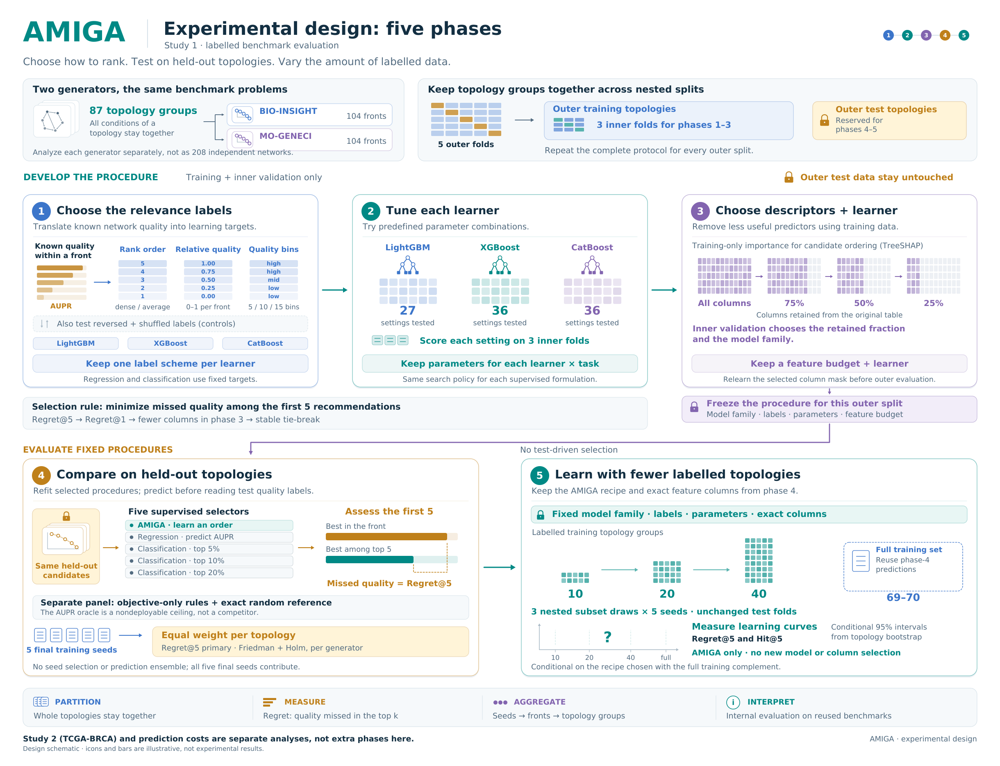

# AMIGA experimental design in five phases

[](AMIGA_experimental_design.pdf)

This diagram describes the labelled benchmark study: relevance labels,
hyperparameters, descriptor/family selection, held-out selector comparison and
fixed-AMIGA learning curves. The real TCGA-BRCA application and prediction costs
are separate analyses. The [software overview](../graphical_abstract/README.md)
shows the reusable training and prediction workflow.

The scientific source is pinned to commit
`f31d550b2e66d8459f143e0f39eaa20aabc028b9`. See the
[protocol](../experiments/design.md), [source map](SOURCES.md) and
[figure description](figure_caption.md). Illustrations are schematic and contain
no measured experimental results.

## Files

| File | Purpose |
| --- | --- |
| `AMIGA_experimental_design.pdf` | One-page vector figure, 420 mm wide. |
| `AMIGA_experimental_design.svg` | Editable text and vector shapes. |
| `AMIGA_experimental_design_outlined.svg` | Vector text paths, independent of installed fonts. |
| `AMIGA_experimental_design.png` | 300-dpi rendering. |
| `AMIGA_experimental_design_preview.png` | Screen preview used in the documentation. |
| `phase_details/phase1.pdf` through `phase5.pdf` | Vector crops of the same composition. |
| `phase_details/phase1.png` through `phase5.png` | Enlarged previews of each phase. |
| `build_figure.py`, `vector_engine.py` | Layout and vector drawing implementation. |
| `figure_text.json`, `figure_config.json` | Wording, colours, fonts and geometry. |
| `design_snapshot.json` | Scientific constants for visualization; not an executable experiment contract. |
| `requirements.txt` | Pinned drawing dependencies. |
| `verify_build.py` | Artifact/source integrity, layout and reconstruction checks. |
| `SOURCES.md`, `provenance.json`, `figure_caption.md` | Implementation mapping and figure interpretation. |
| `build_environment.json`, `layout_checks.json`, `text_geometry.json` | Actual environment, source/font identities and text geometry. |
| `verification_report.json`, `visual_review.json`, `SHA256SUMS` | Reconstruction, visual inspection and file checksums. |

## Generate in an isolated environment

Run from the repository root. Keep drawing dependencies outside the environment
used for AMIGA's experimental executions:

```bash
python3 -m venv /tmp/amiga-design-venv
/tmp/amiga-design-venv/bin/python -m pip install -r docs/experimental_design/requirements.txt
/tmp/amiga-design-venv/bin/python docs/experimental_design/build_figure.py
/tmp/amiga-design-venv/bin/python docs/experimental_design/verify_build.py --rebuild
```

Python 3.10 or newer and DejaVu Sans regular/bold fonts are required. On Debian
and Ubuntu, the fonts are supplied by `fonts-dejavu-core`. Alternatively, pass
`--font-dir /path/to/fonts` to the builder and verifier. Font files are not
redistributed. Editable SVG text requires those fonts for identical display;
the PDF embeds subsets and the outlined SVG uses glyph paths.

Drawing is offline after dependencies are installed. It requires no AMIGA
installation, benchmark datasets, fitted model or reference image. Generation
also produces all five phase details and records the actual build environment.

To render into another directory:

```bash
/tmp/amiga-design-venv/bin/python docs/experimental_design/build_figure.py --out-dir /tmp/amiga-design
/tmp/amiga-design-venv/bin/python docs/experimental_design/verify_build.py --directory /tmp/amiga-design --rebuild --refresh-checksums
```

`--dpi` changes the main PNG resolution. Reconstruction compares against the
configured delivery resolution in `figure_config.json`; set `png_dpi` there when
changing the delivery settings. Exact byte identity requires matching dependency
versions and font hashes.

## Edit and verify

Edit visible wording in `figure_text.json` and panel composition in
`build_figure.py`. `figure_config.json` controls colours, fonts and dimensions.
Changes to protocol constants belong in `design_snapshot.json` after checking
the linked scientific specification.

The phase-4 panel presents classification top-5%, top-10% and top-20% without
asterisks or an implementation-status footnote. Each uses its own full parameter
and feature selection. The linked experimental design describes the analytical
role and interpretation of the threshold comparisons.

After an intentional change, regenerate and refresh the checksums:

```bash
/tmp/amiga-design-venv/bin/python docs/experimental_design/build_figure.py
/tmp/amiga-design-venv/bin/python docs/experimental_design/verify_build.py --rebuild --refresh-checksums
```

Normal verification checks the existing checksum inventory. The refresh option
updates that inventory after an intentional edit, while still checking generated
source/artifact identities and, with `--rebuild`, source-only reconstruction.
The verifier compares all fifteen main/detail exports in an empty temporary
directory using only the five generation inputs. It checks one-page vector PDFs,
editable/outlined SVGs, text-box overlaps and panel bounds.

Visually inspect the preview and phase details after editing. Text-box checks do
not prove that every graphical primitive avoids every other one. All figures
and shapes remain conceptual; no performance curve or empirical value is invented.
